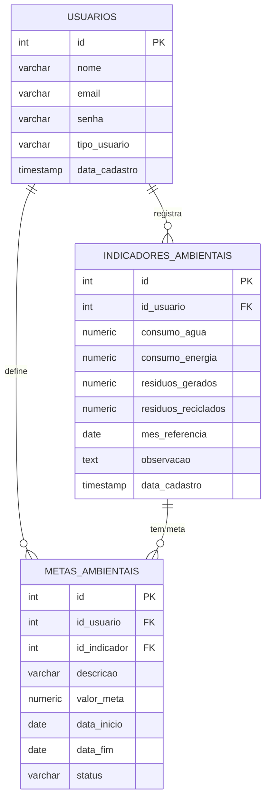

# Modelo de domínio

## Entidades

Uma tabela por entidade. A coluna **Regra** é o que vira `NOT NULL`, `UNIQUE` ou validação no DTO.

### Usuario

Um usuário (gestor, responsável ou administrador) cadastrado no EcoGestor.

| Atributo | Tipo Java | Coluna | Obrigatório | Regra |
|---|---|---|---|---|
| `id` | `Integer` | `id` | sim | Gerado pelo banco |
| `nome` | `String` | `nome` | sim | Até 100 caracteres |
| `email` | `String` | `email` | sim | Até 150 caracteres. Único |
| `senha` | `String` | `senha` | sim | Até 255 caracteres |
| `tipoUsuario` | `String` | `tipo_usuario` | sim | Até 50 caracteres |
| `dataCadastro` | `LocalDateTime` | `data_cadastro` | não | Preenchido automaticamente; o cliente não controla |

### IndicadorAmbiental

Os indicadores ambientais de um usuário em determinado mês (água, energia e resíduos).

| Atributo | Tipo Java | Coluna | Obrigatório | Regra |
|---|---|---|---|---|
| `id` | `Integer` | `id` | sim | Gerado pelo banco |
| `usuario` | `Usuario` | `id_usuario` | sim | Chave estrangeira para `usuarios(id)` |
| `consumoAgua` | `BigDecimal` | `consumo_agua` | sim | `NUMERIC(10,2)`; não negativo (validação no DTO) |
| `consumoEnergia` | `BigDecimal` | `consumo_energia` | sim | `NUMERIC(10,2)`; não negativo (validação no DTO) |
| `residuosGerados` | `BigDecimal` | `residuos_gerados` | sim | `NUMERIC(10,2)`; não negativo (validação no DTO) |
| `residuosReciclados` | `BigDecimal` | `residuos_reciclados` | sim | `NUMERIC(10,2)`; não pode superar `residuosGerados` (R2) |
| `mesReferencia` | `LocalDate` | `mes_referencia` | sim | Único por usuário: `UNIQUE (id_usuario, mes_referencia)` (R1) |
| `observacao` | `String` | `observacao` | não | Texto livre |
| `dataCadastro` | `LocalDateTime` | `data_cadastro` | não | Preenchido automaticamente; o cliente não controla |

### MetaAmbiental

Uma meta de sustentabilidade definida para um indicador e um período.

| Atributo | Tipo Java | Coluna | Obrigatório | Regra |
|---|---|---|---|---|
| `id` | `Integer` | `id` | sim | Gerado pelo banco |
| `usuario` | `Usuario` | `id_usuario` | sim | Chave estrangeira para `usuarios(id)` |
| `indicador` | `IndicadorAmbiental` | `id_indicador` | sim | Chave estrangeira para `indicadores_ambientais(id)` |
| `descricao` | `String` | `descricao` | sim | Até 200 caracteres |
| `valorMeta` | `BigDecimal` | `valor_meta` | sim | `NUMERIC(10,2)`; não negativo (validação no DTO) |
| `dataInicio` | `LocalDate` | `data_inicio` | sim | Início da vigência |
| `dataFim` | `LocalDate` | `data_fim` | sim | Não pode ser anterior a `dataInicio` (`CHECK` no banco) |
| `status` | `String` | `status` | sim | Até 100 caracteres. Nasce `pendente` |

## Regra de negócio das metas

**R3:** um usuário só pode ter uma meta para o mesmo indicador ambiental em cada mês coberto pelo período de vigência. Uma meta que vai de janeiro a março ocupa os três meses; outra meta para o mesmo usuário e indicador não pode ocupar janeiro, fevereiro ou março, ainda que as datas dentro do mês não coincidam. A validação é feita no `MetaAmbientalService` durante `POST /metas-ambientais` e a violação retorna `400`.

## Relacionamentos

| De | Para | Tipo | No banco | No código |
|---|---|---|---|---|
| IndicadorAmbiental | Usuario | muitos para um | `indicadores_ambientais.id_usuario` referencia `usuarios(id)` | `@ManyToOne` em `IndicadorAmbiental` |
| MetaAmbiental | Usuario | muitos para um | `metas_ambientais.id_usuario` referencia `usuarios(id)` | `@ManyToOne` em `MetaAmbiental` |
| MetaAmbiental | IndicadorAmbiental | muitos para um | `metas_ambientais.id_indicador` referencia `indicadores_ambientais(id)` | `@ManyToOne` em `MetaAmbiental` |

## Diagrama ER

O GitHub desenha o bloco abaixo sozinho.

Como ler: `||--o{` é "um para muitos". Um usuário registra zero ou vários indicadores e define zero ou várias metas; cada indicador pode ter zero ou várias metas.

## Migrations

Todas existem em `src/main/resources/db/migration`, uma tabela por arquivo. A ordem importa: a tabela referenciada nasce antes da que referencia.

| Versão | Arquivo | O que cria |
|---|---|---|
| V1 | `V1__criar_usuarios.sql` | Tabela `usuarios` |
| V2 | `V2__criar_indicadores_ambientais.sql` | Tabela `indicadores_ambientais`, com a chave estrangeira para `usuarios` |
| V3 | `V3__criar_metas_ambientais.sql` | Tabela `metas_ambientais`, com as duas chaves estrangeiras |